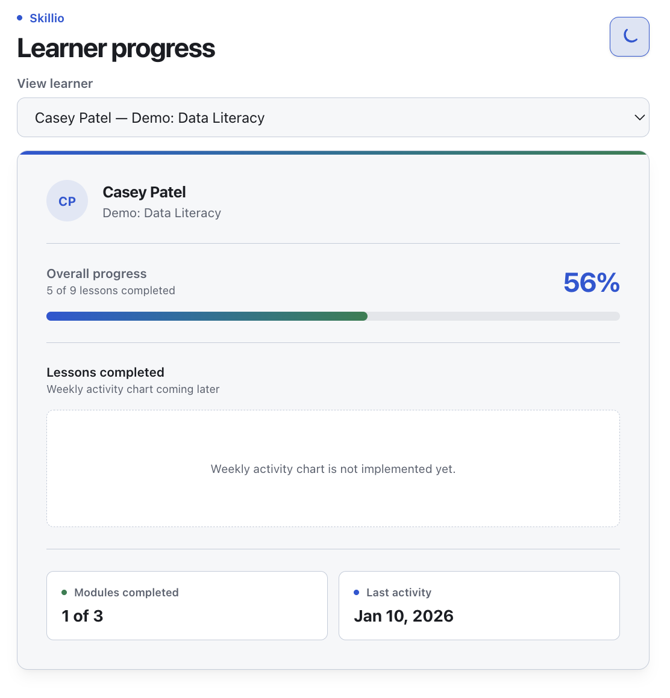
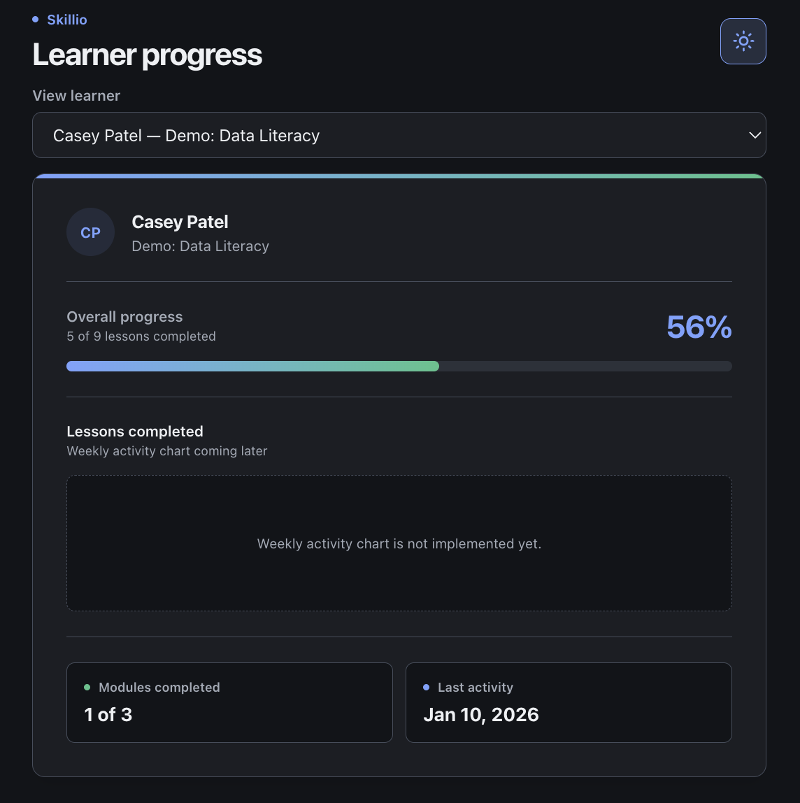

# feat: learner progress dashboard

## Summary

Adds a read-only learner progress dashboard. A reviewer can pick one of five seeded demo
learners and see their name, enrolled program, overall lesson progress, modules completed,
last activity, and weekly lesson completions. The dashboard loads data from an Express API
backed by SQLite, and supports light and dark themes.

The change covers the feature as merged across PRs #1, #2, #5, and #6; this description is
attached to the final PR (#6) as the representative submission.

## What changed

- **Database:** Drizzle schema for `users`, `programs`, `modules`, `lessons`, `enrollments`,
  and `lesson_progress`, with foreign keys, unique indexes, and check constraints; one
  generated migration; an idempotent seed with three programs (three modules and nine lessons
  each) and five learners at different progress stages; constraint and seed tests.
- **API:** `GET /api/learners` and `GET /api/learners/:id/progress`. SQL lives in
  `server/learners/repository.ts`, progress math in `server/learners/progress.ts`, and HTTP
  concerns (validation, 400/404, JSON shape) in `server/routes/learners.ts`. The connection is
  opened once at startup and injected into the router. Weekly completions are grouped by UTC
  weeks starting Monday; last activity is the latest `last_accessed_at` for the learner.
- **Frontend:** React + Vite + TypeScript dashboard with a learner selector, loading, empty,
  and retryable error states, a progress bar, module stats, last-activity text, and a theme
  toggle persisted in `localStorage`. Responses are validated in `client/src/learnerApi.ts`
  before use.
- **Docs and decisions:** ADR-0001 (data model), ADR-0002 (no auth in v1), ADR-0003 (shared
  progress), ADR-0004 (styling and preview), plus README updates.
- **Trade-offs:** progress calculation still lives in `server/learners/progress.ts` instead of
  `shared/` (ADR-0003 follow-up), the API contracts are hand-written validators rather than Zod
  in `shared/`, and v1 stays read-only with no authentication by design.

## How to test

1. Install dependencies and prepare the database:

   ```bash
   npm install
   npm run db:migrate
   npm run db:seed
   ```

2. Start the API in one terminal and the client in another:

   ```bash
   npm run dev:server
   npm run dev
   ```

3. Open the Vite URL and check:
   - the learner selector lists five demo learners with their programs;
   - selecting a learner shows the name, program, progress percentage, modules completed, and
     last activity (or "No activity yet" for the unstarted learner);
   - the theme toggle switches light/dark and survives a reload;
   - stopping the API and retrying shows the error state and retry action.

4. Spot-check the API directly:

   ```bash
   curl http://localhost:3000/api/health
   curl http://localhost:3000/api/learners
   curl http://localhost:3000/api/learners/1/progress
   ```

5. Confirm the checks pass from the repository root:

   - [ ] `npm run typecheck`
   - [ ] `npm run lint`
   - [ ] `npm test`
   - [ ] `npm run build`

## Screenshots

| Light theme | Dark theme |
| :--- | :--- |
|  |  |

## AI notes

- **Tools used:** <!-- TODO -->
- **Used for:** <!-- TODO -->
- **Got wrong, noticed, and fixed:** <!-- TODO -->

## Known limitations and next steps

- Progress calculation and API contracts still live outside `shared/`; moving them there is
  tracked by ADR-0003.
- The API returns weekly completion data, but the dashboard chart is not rendered yet.
- The read-only module list and module-detail view are not implemented.
- There is no Playwright end-to-end coverage and no CI workflow; `lint` currently covers only
  the client workspace.
- Authentication and lesson-completion writes are post-MVP; v1 is intentionally read-only.

## Related

- ADR-0001, ADR-0002, ADR-0003, ADR-0004 in `docs/decisions/`.
- PRs #1, #2, #5, and #6.
