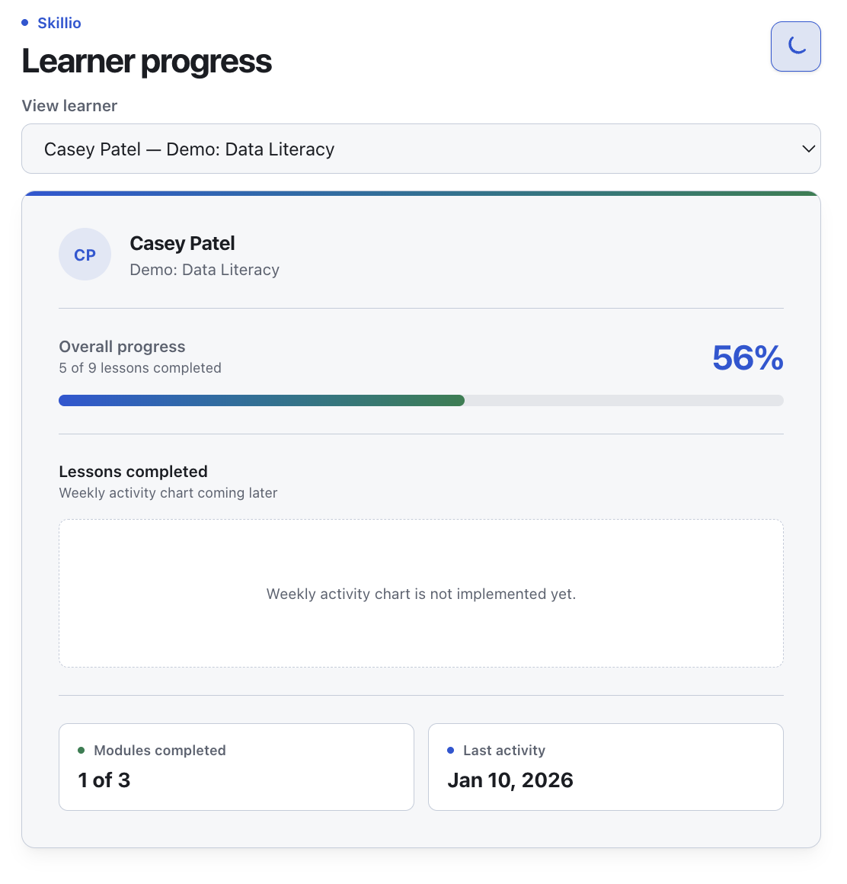
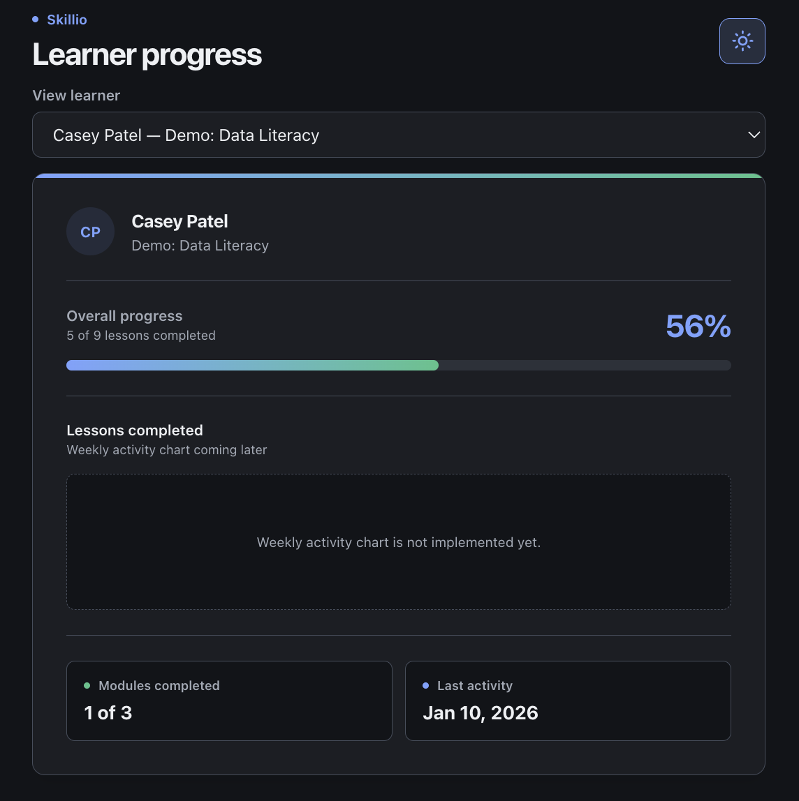
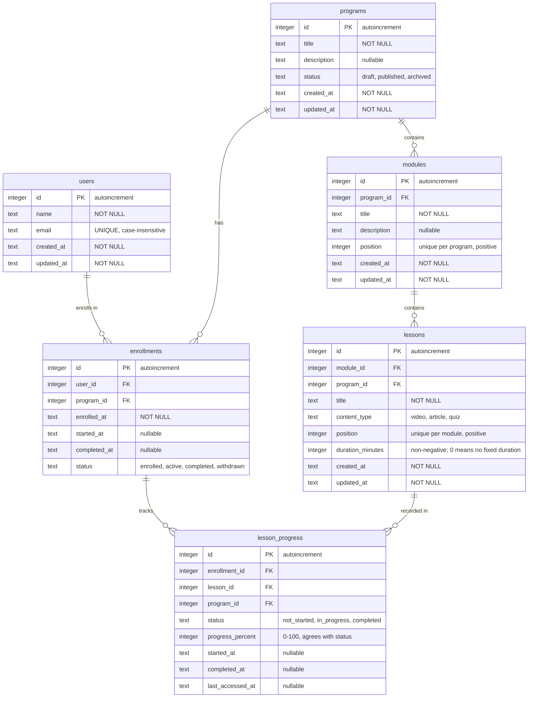

# learner-progress-card


## Screenshots

### Light theme



### Dark theme



## Tech Stack

| Layer | Technology | Role |
| :--- | :--- | :--- |
| Language | TypeScript (strict) | Shared types across client, server, and `shared/` |
| Client | React + Vite | Dashboard UI, dev server, and production build |
| Styling | Tailwind CSS + design tokens | Light/dark theming via CSS custom properties |
| Server | Express | REST API, health check, graceful shutdown |
| Database | SQLite + Drizzle ORM | Schema, migrations, and seed data |
| Contracts | Hand-written validators (Zod planned) | Client checks API responses; shared schemas are still to come |
| Testing | Vitest (Playwright planned) | Unit, database, and API tests; end-to-end flows are still to come |
| Runtime | Node.js | Server process and tooling |

> The dashboard loads learners and progress from the API. The weekly activity chart,
> shared progress/contracts, and Playwright e2e are still planned.
> Dashboard styling uses Tailwind utilities and light and dark colour tokens defined in
> `client/src/index.css`; there is no separate token document.

## v1 features

- [x] Select an available demo learner
- [x] Show the learner's name and enrolled program
- [x] Show overall progress percentage and modules completed out of total
- [x] Show the most recent lesson activity, or "No activity yet"
- [x] Light and dark theme
- [ ] Show a weekly chart of completed lessons

## User flow (v1)

```text
Open Learning Platform
        ↓
Select a demo learner (no sign-in)
        ↓
Open Learning Progress Dashboard
        ↓
View learner name + enrolled program
        ↓
View progress, modules completed / total, and last activity
        ↓
Select a module (planned)
        ↓
View module details and lesson statuses, read-only (planned)
        ↓
Return to progress dashboard
```

## Post-MVP flow

Marking lessons complete and recalculating progress is deferred until after v1.

```text
Select a module
        ↓
┌───────────────────────┐
│ Is module completed?  │
└───────────────────────┘
      ↓ Yes        ↓ No
Review module    Continue learning
      ↓                ↓
View results     Complete lessons
      └───────┬────────┘
              ↓
      Progress updates
              ↓
 Return to progress dashboard
```

## v1 scope

v1 is a read-only demo: three seeded programs with five learners at different progress
stages, and no sign-in, registration, or password reset. The dashboard offers a dropdown
to select a demo learner. Anyone who can access the demo can view their data; selection is
not authentication. Progress is seeded, so the "Complete lessons" loop in the post-MVP flow
is not part of v1. Last activity is the latest recorded lesson access across the selected
learner's progress records, or "No activity yet" when none exists. See
`docs/decisions/ADR-0002-no-auth-v1.md` for the no-auth decision.

## Current status

The read-only dashboard is connected to the Express API and SQLite seed data. It supports
learner selection, shows learner and program details, lesson and module progress, and last
activity, and has light/dark themes with higher-contrast borders. The API also returns weekly
lesson-completion data, but the dashboard chart is not implemented yet.

`typecheck`, `lint`, `test`, and `build` pass. The test suite covers the database constraints and
seed, the API routes and progress calculation, and the client's API validators. The `shared/`
workspace is still a scaffold: it has no progress calculation or Zod contracts yet, so the
server calculates progress and the client validates responses locally.

A GitHub Actions workflow runs `typecheck`, `lint`, `test`, and `build` on pushes to `main` and
on pull requests. There is no end-to-end test configuration yet.

## Next implementation steps

1. Move progress calculation and API contracts into `shared/`, then update the server and client
   to use them. A draft `computeProgress()` implementation and tests exist but are not integrated
   yet.
2. Render the API's weekly completion data as a dashboard chart, including an empty state.
3. Implement the read-only module list and module-detail view, if they remain part of v1.
4. Add Playwright end-to-end coverage for learner selection, loading/error states, and both
   themes.

Authentication and lesson-completion writes remain post-MVP; v1 is a read-only demo.

## Project structure

| Path | Purpose |
| :--- | :--- |
| `client/` | React + Vite dashboard |
| `server/` | Express API |
| `database/` | Drizzle schema, migrations, seed, and database tests |
| `shared/` | Shared types, Zod schemas, and progress logic (planned) |
| `test/` | Playwright end-to-end tests (planned) |
| `docs/decisions/` | Architecture decision records |

## Data model

Six tables, with `lesson_progress` as the fact table joining *who* (enrollment) to *what* (lesson):



A user enrolls in a program (via `enrollments`), and each lesson they take gets one
`lesson_progress` row tied to that enrollment. Overall progress is derived from those rows:
only `status = 'completed'` lessons count.

The diagram omits two details enforced in the schema: several foreign keys are composite —
`lesson_progress` references `(enrollment_id, program_id)` and `(lesson_id, program_id)` so
progress can never be recorded against a lesson outside the enrolled program — and deleting
a lesson cascades to its progress rows. See `docs/decisions/ADR-0001-data-model.md` for the
model's conventions and `database/schema.ts` for the authoritative schema.

## Development

Prerequisites: Node.js (LTS) and npm. The repository is an npm workspace monorepo; the
`client`, `server`, and `shared` packages are workspaces, and all commands run from the
repository root.

Install dependencies:

```bash
npm install
```

Create and seed the local SQLite database before starting the server:

```bash
npm run db:migrate
npm run db:seed
```

The seed command creates three demo programs with three modules and nine lessons each, plus
five learners assigned across the programs at different progress stages: not started, early
progress, mid-progress, nearly complete, and completed. It is safe to run repeatedly.

Start the Express server:

```bash
npm run dev:server
```

In a second terminal, start the Vite client:

```bash
npm run dev
```

Open the URL printed by Vite. Its development proxy forwards `/api` requests to the server on
port 3000. The health endpoint is at `http://localhost:3000/api/health`.

The server provides `GET /api/learners` and `GET /api/learners/:id/progress`. The latter
reports weekly lesson completions grouped by UTC weeks starting on Monday, and uses the
learner's first enrollment when multiple exist. The dashboard loads both endpoints through the
Vite proxy.

Run the checks from the repository root:

```bash
npm run typecheck
npm run lint
npm test
npm run build
```

`npm run lint` currently covers the client workspace; lint configuration for `server/` and
`shared/` is still to come. `npm test` runs the client, server, and shared tests plus the
database tests, which apply the migrations to an in-memory database and verify the schema
constraints.

After changing `database/schema.ts`, generate a new migration before applying it:

```bash
npm run db:generate
npm run db:migrate
```

Set `DATABASE_PATH` to use a different database file (see `.env.example`). Generated migrations
in `database/migrations/` are committed; the database file under `database/data/` is ignored.

End-to-end commands will be added once Playwright is configured.
